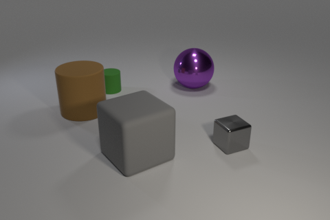
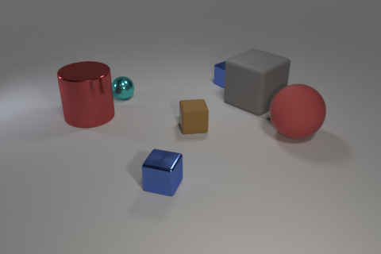
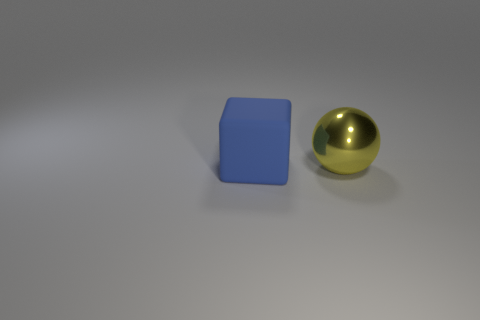
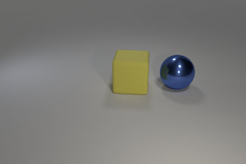
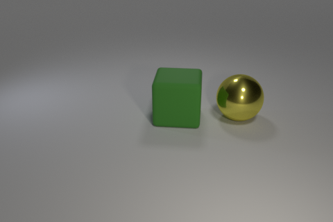
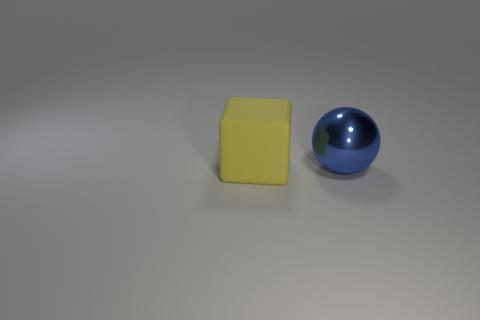
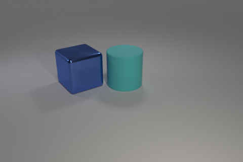
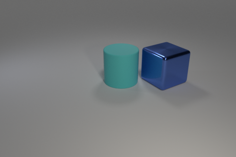
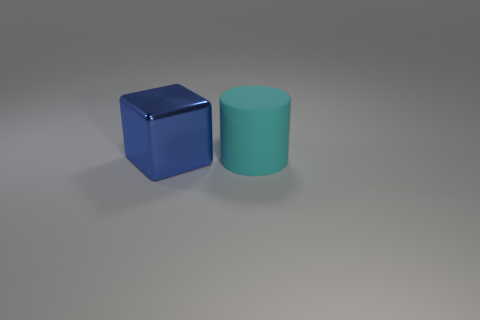

# GraphDelta 预实验总说明（每步干什么 + 实际示例 + 全部参数）

对应《GraphDelta_研究框架_统一修订版》《GraphDelta_完整预实验方案_统一修订版》与
《[下一步工作方案：受控结构编辑与迁移验证](../下一步工作方案_受控结构编辑验证_2026-11-03.md)》。
本文件是预实验的总说明：每一步讲清楚做什么、为什么做、给一个真实数据里的例子、
列出执行命令的**全部参数**及每个参数的可选取值和含义。更细的操作细节见
[`PreExperiments/README.md`](PreExperiments/README.md) 与两个阶段目录的 README。

本文用的示例图片都放在 `docs/images/`（来源见 §8），是真实数据或真实渲染产物，
不是示意图。

## 1. 这套代码在做什么

研究问题：在相同数据、可训练容量和训练预算下，图编辑指导的上下文相关变化学习，
能否提高模型对未见属性组合与关系结构的图文匹配能力。

回答它之前必须先知道两件事，否则训练无从设计：

1. 冻结的预训练模型在这些结构因素上到底哪里弱、弱多少——决定主实验的动机
   和数据构造重点；
2. 受控的结构编辑在冻结表示里留下多大可读出的信号——决定训练路线（全局
   适配 / 局部表示 / 骨干更新）是否有依据。

预实验分两阶段，之后直接进入主实验：

| 阶段 | 内容 | 状态 |
|---|---|---|
| 阶段一 | 冻结 baseline 诊断（E1–E3），公开数据 + 固定协议，只评估不训练 | 已完成，结果冻结 |
| 阶段二 | 受控结构编辑验证（E4），自建受控数据 + 诊断，骨干冻结、只训线性探针 | 代码完成，冒烟链路通过，正式全量待运行 |

代码全部在 `PreExperiments/`（共用模块 `common/`，阶段目录 `stage1_frozen_baseline/`、
`stage2_controlled_edit/`）；配置在 `configs/`，数据在 `data/`，结果在 `outputs/`
（位置都不随代码目录变动）。

## 2. 运行环境与前提

```bash
cd GraphDelta/code
conda run -n CudaVersion128Fuxp python <script>
# python 3.10 / torch 2.7.0+cu128 / transformers 5.x / pandas / pyarrow
```

所有脚本以 `__file__` 锚定路径，任意目录可运行。前提是 `configs/paths.yaml`
里配置的路径真实存在：

| 项 | 配置位置 | 值 |
|---|---|---|
| CLEVR v1.0 | `datasets.clevr` | `/mnt/disk1/xpfu/datasets/CLEVR_v1.0`（val 15,000 张） |
| CLEVR-CoGenT v1.0 | `datasets.cogent` | `.../CLEVR_CoGenT_v1.0`（valA / valB 各 15,000 张） |
| PUG:SPAR | `datasets.pug_spar` | `.../facebook/PUG_SPAR`（43,560 张，纯评测集） |
| PUG:Animals | `datasets.pug_animals` | `.../facebook/PUG_Animals`（215,040 张） |
| PUG:ImageNet | `datasets.pug_imagenet` | `.../facebook/PUG_ImageNet`（88,328 张） |
| CLIP ViT-L/14 | `models.clip_vitl14` | 首选 baseline |
| CLIP ViT-B/32 | `models.clip_vitb32` | 对照模型 |
| SigLIP2 so400m | `models.siglip2_so400m` | 对照模型（FixRes checkpoint，384×384） |
| Blender 2.78c + clevr-dataset-gen | `render`（仅阶段二用） | 渲染输出目录在仓库外 |

路径不齐时 `resolve_models` / `load_paths` 会直接报错并列出可用值，不会静默运行。

## 3. 所有脚本共用的参数约定

**`--model`**（出现在所有加载模型和读结果的脚本里，取值固定 4 个，**默认 `all`**）：

| 取值 | 含义 |
|---|---|
| `all` | 默认值。不是一个模型：按 `clip_vitl14 → clip_vitb32 → siglip2_so400m` 顺序串行跑全部已配置模型，一次只加载一个 |
| `clip_vitl14` | CLIP ViT-L/14，特征 768 维，224×224 官方预处理，首选 baseline |
| `clip_vitb32` | CLIP ViT-B/32，特征 512 维，224×224 官方预处理 |
| `siglip2_so400m` | SigLIP2 so400m，特征 1152 维，384×384 预处理，文本编码前显式小写 |

同样规则适用于其他支持 `all` 的参数：`--task`（阶段二清单 / 渲染）、`--dataset`
（特征抽取必填除外、E2、manifest）默认都是 `all`，省略即跑全部。

三个模型完全冻结（`eval()` + `requires_grad=False`），各用各的官方预处理和
tokenizer。结果按 `outputs/<model>/seed_<k>/tables/` 目录隔离，换模型不会覆盖。

**开关类参数**（带上即生效，不带即关闭）：

| 参数 | 含义 |
|---|---|
| `--smoke` | 小样本快速自检，输出文件名带 `_smoke` 后缀，不写正式结果 |
| `--force` | （仅特征抽取）删除已有缓存重抽 |
| `--allow-empty-factors` | （仅 E2）某因素 0 对有效配对时跳过该因素而不是停止 |

**`--seed`**（任意整数）：控制采样 / 置换 / bootstrap 的随机性，不参与训练。
方案固定用 0 / 1 / 2 三个种子重复实验，检验结论是否稳定；结果自动写入
`seed_0/`、`seed_1/`、`seed_2/` 目录。

**结果登记**：每个实验启动时在 `run_meta.json` 登记 `running`，全部产物成功
写出后才标 `success`；提交时逐产物记录内容摘要（`outputs_md5`），汇总端用它
核对磁盘文件没被后来的中断运行覆盖过。全部 CSV / JSON 原子写出（先写临时文件
再替换），中断不留半写文件。

## 4. 阶段一：冻结 baseline 诊断（E1–E3，已完成）

阶段一只评估、不训练：代码里没有 optimizer / loss / backward / 微调。

### 4.0 Step 0 数据准备（一次性，已完成）

**做什么**：整理 PUG 三个数据集的 manifest，再把各数据集全部图像编码成特征缓存。

**为什么**：特征只抽一次，后续所有实验读缓存，把 GPU 时间和实验时间分开。
缓存目录带 `protocol.json` 指纹，预处理语义变更后旧缓存直接报错，防止静默串用。

**怎么执行**（两个脚本，全部参数记号；实际执行时加 `conda run -n
CudaVersion128Fuxp ` 前缀，并把每个 `[...]` 替换成一个具体值。下同）：

```bash
# 1) manifest（PUG 数据集的图片存在 parquet 分片里，manifest 记录每行的元数据；一次性）
python PreExperiments/stage1_frozen_baseline/scripts/build_manifests.py --dataset [all(默认), pug_spar, pug_animals, pug_imagenet]
# 2) 特征抽取（首次全量约数小时 GPU；实验脚本发现缓存缺失也会自动补抽）
python PreExperiments/stage1_frozen_baseline/scripts/extract_embeddings.py --dataset [all, clevr_val, cogent_valA, cogent_valB, pug_spar, pug_spar_official, pug_animals, pug_imagenet]（必填，无默认） --model [all(默认), clip_vitl14, clip_vitb32, siglip2_so400m] --force（开关）
```

具体执行（示例值，可直接复制，前缀见 §2）：

```bash
conda run -n CudaVersion128Fuxp python PreExperiments/stage1_frozen_baseline/scripts/build_manifests.py --dataset all
conda run -n CudaVersion128Fuxp python PreExperiments/stage1_frozen_baseline/scripts/extract_embeddings.py --dataset all --model all
```

`build_manifests.py` 参数（共 1 个）：

| 参数 | 取值 | 默认 | 含义 |
|---|---|---|---|
| `--dataset` | `all` / `pug_spar` / `pug_animals` / `pug_imagenet` | `all` | 生成哪个数据集的 manifest（`data/manifests/<dataset>_meta.parquet`）；`all` = 依次生成全部三个。只整理已有数据，不动任何图像 |

`extract_embeddings.py` 参数（共 3 个）：

| 参数 | 取值 | 默认 | 含义 |
|---|---|---|---|
| `--dataset` | `all` / `clevr_val` / `cogent_valA` / `cogent_valB` / `pug_spar` / `pug_spar_official` / `pug_animals` / `pug_imagenet` | 无（必填） | 抽哪个数据集的特征。`all` = 全部 7 个串行；`pug_spar_official` 是 SPAR 官方协议专用的另一套预处理（Resize 224 + ImageNet mean/std），缓存单独存 |
| `--model` | 同 §3 的 4 个取值 | `all` | 用哪个（哪些）模型抽特征 |
| `--force` | 开关 | 不带 | 删除已有缓存重抽 |

`--dataset all --model all` 时嵌套顺序是模型在外层、数据集在内层。缓存按样本
id 增量补齐：已抽过的跳过，缺的补抽。每个样本存 raw 和 normalized 两份 embedding
（`data/cache/<model>/`，float16）。

### 4.1 E1 状态级结构诊断：能力是否不均衡

**做什么**：给模型一张图和两句描述（一句真、一句假），看它给真句的打分是否
更高（2AFC）。真句假句只差一处结构因素，哪类因素错得多，就说明模型在那类
结构上弱。

**为什么**：这是主实验动机的直接来源。一个必须排除的干扰：模型可能学会
"永远选某个词"而不是真的看图。所以 target 子样本按正例取值分层等额抽取，
让这种答题策略的期望准确率恰好 50%；逐侧准确率之差就是词偏好的直接证据。

**CLEVR 侧的真实例子**（六类因素，图像不变只换文本候选）：



这张图是 `CLEVR_val_000000.png`，场景里有 5 个物体（大的棕色橡胶圆柱体、大的
灰色橡胶立方体、小的绿色橡胶圆柱体、大的紫色金属球、小的灰色金属立方体）。
E1 对它构造的其中一条样本（object 因素）：

| 因素 | 正例（真） | 负例（假） | 考什么 |
|---|---|---|---|
| object | a large gray rubber **cube** | a large gray rubber **cylinder** | 认得出物体形状 |
| color | a large **gray** rubber cube | a large **red** rubber cube | 认得出颜色 |
| size | a **large** gray rubber cube | a **small** gray rubber cube | 认得出大小 |
| material | a large gray **rubber** cube | a large gray **metal** cube | 认得出材质 |
| relation | a large gray rubber cube is **left of** a large purple metal sphere | a large gray rubber cube is **right of** a large purple metal sphere | 认得出空间关系（真句方位取自官方场景标注） |
| binding | a **gray** cube and a **purple** sphere | a **purple** cube and a **gray** sphere | 颜色和形状的绑定（归属交换后两句用的词完全相同，只是组合错了） |

object 一行是这条图上真实采到的样本（`e1_items_clevr.jsonl` 第一条，模型答对，
margin 0.084）；其余五行展示同一对物体上各类负例的构造方式。

每条样本都过"正例为真、负例为假"检查（用官方场景标注验证），无效样本丢弃
并计数。报告每类因素的 2AFC 准确率、margin、模板方差，以及按正例取值分层的
准确率（查词偏好）。

**SPAR 侧的真实例子**（四类因素）：


这张图是 `pug_spar_006002`（arena 场景，左边一条蓝色贴图的 BlackRockFish，
右边一条红色贴图的 WhiteShark）。四类因素各构造一对文本，attribute 一行是
这条图上真实采到的样本（见 §5.1 审查清单里的同一题）：

| 因素 | 正例（真） | 负例（假） |
|---|---|---|
| scene | a BlackRockFish and a WhiteShark in the arena | a BlackRockFish and a **Squirrel** in the arena（把一只动物换成场景里不存在的动物，场景词不变） |
| position | the BlackRockFish is **left of** the WhiteShark | the BlackRockFish is **right of** the WhiteShark |
| attribute | a **blue** BlackRockFish and a **red** WhiteShark | a **red** BlackRockFish and a **blue** WhiteShark（两只动物的贴图颜色互换） |
| relation | the **BlackRockFish** is left of the WhiteShark | the **WhiteShark** is left of the BlackRockFish（主客体互换，方位词不变） |

**怎么执行**（一次运行同时覆盖 CLEVR 和 SPAR，结果用 `dataset` 列区分）：

```bash
python PreExperiments/stage1_frozen_baseline/scripts/run_e1.py --model [all(默认), clip_vitl14, clip_vitb32, siglip2_so400m] --smoke（开关） --seed [0(默认), 1, 2, …]
# SPAR 官方协议复现（全候选检索 + hard negative 二选一，与自建 2AFC 分开报告）
python PreExperiments/stage1_frozen_baseline/scripts/run_e1_spar_official.py --model [all(默认), clip_vitl14, clip_vitb32, siglip2_so400m] --smoke（开关） --seed [0(默认), 1, 2, …]
```

具体执行（示例值）：

```bash
conda run -n CudaVersion128Fuxp python PreExperiments/stage1_frozen_baseline/scripts/run_e1.py --model all --seed 0
conda run -n CudaVersion128Fuxp python PreExperiments/stage1_frozen_baseline/scripts/run_e1_spar_official.py --model all --seed 0
```

`run_e1.py` 参数（共 3 个）：

| 参数 | 取值 | 默认 | 含义 |
|---|---|---|---|
| `--model` | §3 的 4 个取值 | `all` | 评估的模型 |
| `--smoke` | 开关 | 不带 | 小样本自检，输出带 `_smoke` 后缀 |
| `--seed` | 任意整数 | 配置 `seeds[0]`（=0） | 候选采样种子；`--seed 1`、`--seed 2` 重跑进 `seed_1/`、`seed_2/` |

`run_e1_spar_official.py` 参数（共 3 个）：

| 参数 | 取值 | 默认 | 含义 |
|---|---|---|---|
| `--model` | `all` / `clip_vitl14` / `clip_vitb32` / `siglip2_so400m` | `all` | 评估的冻结 baseline；`all` = 三个模型串行依次评估 |
| `--smoke` | 开关 | 不带 | 小样本快速自检（只取前 3000 行，部分任务样本很少或为空，全量才有可比数字） |
| `--seed` | 任意整数 | 配置 `seeds[0]`（=0） | 查询图片抽样种子 |

### 4.2 E2 单因素表示响应：变化有没有稳定规律

**做什么**：在 PUG:Animals 的完整笛卡尔积（70 动物 × 64 环境 × 3 大小 × 4 纹理
× 4 相机，每个组合恰好一张图）里，固定其余因素、只变一个因素，计算视觉特征的
变化量 Δ = after − before，看这个变化量有没有稳定方向和大小。

**为什么**：如果单因素变化在特征空间里没有稳定规律，任何"变化向量可迁移"的
设计都没有依据。必须有一个"没有语义变化时特征本来就会变多少"的水平线做参照
（nuisance 基线：同一张图两次确定性增强之差、同内容不同模板文本之差），因素
响应超出它才算信号。

**真实例子**：下面两张图都是同一只 Ammonite、同一贴图（Default）、同一大小
（small）、同一相机角度（0°），只有环境不同（Egypt → Desert）：

<p>


</p>
<p>左：pug_animals_000000（Egypt）；右：pug_animals_000048（Desert）。</p>

E2 对这样的图对计算 Δv = z(Desert 图) − z(Egypt 图)，主指标 Transition
Similarity Gap = 同一转换在不同环境里的相似度 − 不同因素变化的相似度。
四个因素：environment / texture / size / camera。

**怎么执行**：

```bash
python PreExperiments/stage1_frozen_baseline/scripts/run_e2.py --model [all(默认), clip_vitl14, clip_vitb32, siglip2_so400m] --dataset [all(默认), pug_animals, pug_imagenet] --smoke（开关） --seed [0(默认), 1, 2, …] --allow-empty-factors（开关）
```

具体执行（示例值）：

```bash
conda run -n CudaVersion128Fuxp python PreExperiments/stage1_frozen_baseline/scripts/run_e2.py --model all --dataset all --seed 0
```

`run_e2.py` 参数（共 5 个）：

| 参数 | 取值 | 默认 | 含义 |
|---|---|---|---|
| `--model` | §3 的 4 个取值 | `all` | 评估的模型 |
| `--dataset` | `pug_animals` / `pug_imagenet` / `all` | `all` | `pug_animals` = 核心数据集（215,040 张）；`pug_imagenet` = 辅助验证（检查规律是否只在动物场景成立）；`all` = 两个串行，animals 在前 |
| `--smoke` | 开关 | 不带 | 小样本自检（smoke 下 pug_imagenet 因素覆盖不全，需配 `--allow-empty-factors`） |
| `--seed` | 任意整数 | 配置 `seeds[0]`（=0） | 配对与 nuisance 采样种子 |
| `--allow-empty-factors` | 开关 | 不带 | 某因素 0 对有效配对时跳过该因素而不是停止；开启后结果不构成完整因素集 |

### 4.3 E3 组合难度不对称：未见组合是否更难

**做什么**：CLEVR-CoGenT 的训练集分成 Condition A（立方体只有
gray/blue/brown/yellow 四色）和 Condition B（立方体只有 red/green/purple/cyan
四色）。在 valA / valB 上构造"正确颜色-形状描述 vs 换色 / 换形描述"的 2AFC，
报告 A−B Difficulty Gap。sphere 在两组都可取全 8 色，作颜色词难度对照组。

**为什么**："未见组合是否更难"是主实验组合留出设计的依据。sphere 对照把
"颜色词本身难"和"组合未见更难"两种效应分开，避免把前者误读成后者。

**真实例子**：



这张图是 `CLEVR_valA_000000.png`（Condition A）。场景里有 7 个物体，其中有一个
小的蓝色金属立方体。E3 对它构造的样本：

| | 描述 | 真假 |
|---|---|---|
| 正例 | a **blue** cube | 真：场景里确实有蓝色立方体 |
| 负例 | a **red** cube | 假：场景里没有红色立方体（负例颜色从场景中不存在的颜色-形状组合里随机采样，此处以 red 为例） |

在 valB 上做同样的事（valB 的立方体只能出现 red/green/purple/cyan）。如果模型
在"训练时见过的组合"上明显比"未见过的组合"准，A−B gap 就不为零。

**怎么执行**：

```bash
python PreExperiments/stage1_frozen_baseline/scripts/run_e3.py --model [all(默认), clip_vitl14, clip_vitb32, siglip2_so400m] --smoke（开关） --seed [0(默认), 1, 2, …]
# 逐 (shape_group, color) 单元分析：检查效应是否被平均抵消（16 个单元分别算 gap）
python PreExperiments/stage1_frozen_baseline/scripts/analyze_e3_units.py --model [all(默认), clip_vitl14, clip_vitb32, siglip2_so400m] --seed [0(默认), 任意整数] --tables-dir [任意目录路径(默认不带)] --no-strict（开关） --check-atol [1e-8(默认), 任意浮点数]
```

具体执行（示例值）：

```bash
conda run -n CudaVersion128Fuxp python PreExperiments/stage1_frozen_baseline/scripts/run_e3.py --model all --seed 0
conda run -n CudaVersion128Fuxp python PreExperiments/stage1_frozen_baseline/scripts/analyze_e3_units.py --model all --seed 0
```

`run_e3.py` 参数（共 3 个）：

| 参数 | 取值 | 默认 | 含义 |
|---|---|---|---|
| `--model` | §3 的 4 个取值 | `all` | 评估的模型 |
| `--smoke` | 开关 | 不带 | 小样本自检，输出带 `_smoke` 后缀 |
| `--seed` | 任意整数 | 配置 `seeds[0]`（=0） | 候选采样种子 |

`analyze_e3_units.py` 参数（共 5 个）：

| 参数 | 取值 | 默认 | 含义 |
|---|---|---|---|
| `--model` | §3 的 4 个取值 | `all` | 结果所属模型，定位 `outputs/<model>/seed_<seed>/tables`；不能与 `--tables-dir` 同用 |
| `--seed` | 任意整数 | `0` | 结果所属种子 |
| `--tables-dir` | 任意目录路径 | 不带 | 直接指定 tables 目录（优先于 `--model`） |
| `--no-strict` | 开关 | 不带 | 总 gap 复算与主表不一致时仍输出单元表（探索模式；检查结果始终写入 `e3_unit_consistency.json`） |
| `--check-atol` | 任意浮点数 | `1e-8` | 总 gap 复算与主表对照的绝对容差 |

### 4.4 汇总与阶段判定

**做什么**：三种子（0/1/2）重复上面四个实验后，检验关键判定是否抗采样噪声，
生成五张诊断图，写阶段总结。

**怎么执行**（先补齐 `--seed 1`、`--seed 2` 两遍，再汇总）：

```bash
python PreExperiments/stage1_frozen_baseline/scripts/summarize_seed_stability.py --model [all(默认), clip_vitl14, clip_vitb32, siglip2_so400m] --allow-mixed-legacy（开关） --allow-exploratory-e3（开关）
python PreExperiments/stage1_frozen_baseline/scripts/make_figures.py --model [all(默认), clip_vitl14, clip_vitb32, siglip2_so400m] --seed [0(默认), 任意整数] --tables-dir [outputs/<model>/seed_<seed>/tables(默认), 任意目录路径]
```

具体执行（示例值）：

```bash
conda run -n CudaVersion128Fuxp python PreExperiments/stage1_frozen_baseline/scripts/summarize_seed_stability.py --model all
conda run -n CudaVersion128Fuxp python PreExperiments/stage1_frozen_baseline/scripts/make_figures.py --model all --seed 0
```

`summarize_seed_stability.py` 参数（共 3 个）：

| 参数 | 取值 | 默认 | 含义 |
|---|---|---|---|
| `--model` | §3 的 4 个取值 | `all` | 汇总的模型（各模型三种子缺全量结果时直接报错停止） |
| `--allow-mixed-legacy` | 开关 | 不带 | 三种子混用新旧目录布局时仍输出（仅作版本临时对照） |
| `--allow-exploratory-e3` | 开关 | 不带 | E3 派生单元表状态异常时仍汇总，但写入独立的 `seed_stability_exploratory.csv` |

`make_figures.py` 参数（共 3 个）：

| 参数 | 取值 | 默认 | 含义 |
|---|---|---|---|
| `--model` | §3 的 4 个取值 | `all` | 结果所属模型；不能与 `--tables-dir` 组合用 `all` |
| `--seed` | 任意整数 | `0` | 结果所属种子 |
| `--tables-dir` | 任意目录路径 | `outputs/<model>/seed_<seed>/tables` | 直接指定 tables 目录 |

阶段一结论入口：E1 词偏好与因素分类、E2 单因素响应、E3 组合难度、情况
A/B/C/D 对照，见 `outputs/STAGE1_SUMMARY.md` 与
`outputs/analysis/预实验分析报告_平衡采样_2026-11-03.md`。

## 5. 阶段二：受控结构编辑验证（E4）

**要回答的问题**：受控的结构编辑在冻结表示里留下多大信号。公开数据测不了
"同一场景只改一处结构"的因果问题（找不到只差一处的一对图），所以必须自己
生成数据：先用纯逻辑采样带种子的场景规格，再用规格驱动 Blender 渲染。

**阶段二各步的种子参数**（`--seed` 只出现在两个脚本里，作用不同）：

| 脚本 | 种子 | 作用 |
|---|---|---|
| `export_audit_items.py` | 无参数（内部固定 20261103） | 审查清单的抽样固定、可复现 |
| `build_edit_pairs.py` | `--seed`，默认 20261103 | **数据生成种子**：决定采哪些基础场景、60/20/20 怎么划分；换值 = 换一份数据，须分别报告 |
| `render_edit_pairs.py` | 无 | 渲染由场景规格完全决定，是确定性的，不需要随机种子 |
| `run_e4.py` | `--seed`，默认 0 | **统计采样种子**：决定置换检验 / bootstrap / 探针的抽样；结果写进 `outputs/<model>/seed_<seed>/` 目录 |
| `summarize_e4.py` | `--seed`，默认 0 | 不做任何采样，只用它**定位**汇总哪个 seed 目录的结果，必须与 `run_e4.py` 实际用的 seed 一致 |

所以流程里第 1–3 步不出现统计种子（第 2 步的 `--seed` 是数据生成种子），
第 4 步 `run_e4.py --seed` 生成 `seed_<k>/` 结果，第 5 步 `summarize_e4.py
--seed` 只是指出要读哪个 `seed_<k>/` 目录。

### 5.0 阶段二的数据长什么样

一个**编辑对** = 同一场景的 before / after 两张图 + 一个只改一处结构的编辑。
四类编辑对（默认配额）：

| 编辑类型 | 数量 | 改什么 | 不变什么 |
|---|---:|---|---|
| 颜色归属交换 swap（主任务） | 800 对 | 两个对象的颜色互换 | 形状、位置、大小、材质、相机、光照、背景全不变 |
| 目标换色 recolor（正控制） | 200 对 | 只改 target 对象的颜色（新色取其余 6 色） | 其余一切 |
| 左右关系反转 flip | 500 对 | 把对象 a 从 b 左侧移动到右侧（关于 b 的点反射） | 间距与深度、其余一切 |
| 无语义扰动（对照） | 200 对 | JPEG 压缩 / 轻微裁剪 / 共同平移，语义零变化 | 一切语义 |

**绑定任务真实例子**（`cubsph_blye_00000`，转换 = cube/sphere/blue/yellow）：
大的蓝色橡胶立方体（target）+ 大的黄色金属球。四个状态：

<p>


</p>
<p>左 before（::before）：T0 = "a blue cube and a yellow sphere"；右 swap（::swap）：颜色互换，T1 = "a yellow cube and a blue sphere"。</p>

<p>


</p>
<p>左 recolor（::recolor）：立方体换成绿色（词集变了）；右 jpeg（::swap::jpeg）：swap 图存成 quality 75 的 JPEG，语义零变化。</p>

**关系任务真实例子**（`rel_cume-cyru_00000`，类型对 = cube:metal | cylinder:rubber）：
蓝色金属立方体（a）+ 青色橡胶圆柱（b）：

<p>


</p>
<p>左 before：T0 = "the cube is to the left of the cylinder"；右 flip：a 关于 b 点反射到另一侧，T1 = "the cube is to the right of the cylinder"。</p>

<p>

</p>
<p>translate：两个对象一起平移一小段，左右关系不变（无语义变化对照）。</p>

每个编辑对在清单里存：`pair_id`、`base_scene_id`、编辑类型、家族（绑定的
转换 / 关系的类型对）、前后状态引用、前后场景规格（spec JSON）、结构化编辑
指令、`word_set_changed`、划分（家族内 60/20/20 训练 / 验证 / 留出，划分先于
任何估计固定，`splits.json` 记录清单 md5，改动即报错）。

### 5.1 Step 1 题目审计：先把数据问题排除掉

**做什么**：导出 SPAR 两类稳定低于 50% 的题型（attribute / relation）与 CLEVR
binding 对照的逐题审查清单和原图，供人工核验正句为真、负句为假、对象可见、
指代无歧义。

**为什么**：E1 的低分可能来自数据错误而不是模型缺陷；先抽查排除数据问题，
后续诊断才有解释力。

**真实例子**（`outputs/audit/e1_audit_checklist.csv` 的一行，正是 §4.1 那张
SPAR 图）：

```csv
spar,pug_spar_006002,attribute,phrase,a blue BlackRockFish and a red WhiteShark,
a red BlackRockFish and a blue WhiteShark,arena,BlackRockFish,WhiteShark,Blue,Red,
left,right,clip_vitl14=0.000;clip_vitb32=0.905;siglip2_so400m=0.429,-0.0183,分歧,...
```

三个模型对这题的得分很不一致（ViT-L/14 全错、ViT-B/32 基本对），这类"分歧"
层的题进审查清单。三模型三种子逐题成绩聚合成"一致错 / 分歧 / 一致对"三层，
按 40/40/20 抽样，层内按正例取值轮转。

**怎么执行**（全量约 1 分钟，输出 `outputs/audit/`，251 题）：

```bash
python PreExperiments/stage2_controlled_edit/scripts/export_audit_items.py --spar-per-class [100(默认), 任意正整数] --clevr-n [50(默认), 任意正整数]
```

具体执行（示例值，可直接复制）：

```bash
conda run -n CudaVersion128Fuxp python PreExperiments/stage2_controlled_edit/scripts/export_audit_items.py --spar-per-class 100 --clevr-n 50
```

`export_audit_items.py` 参数（共 2 个）：

| 参数 | 取值 | 默认 | 含义 |
|---|---|---|---|
| `--spar-per-class` | 任意正整数 | `100` | SPAR 每类低分题型的抽查题数；层内 40/40/20 配额等比缩放 |
| `--clevr-n` | 任意正整数 | `50` | CLEVR binding 对照题数，三层均分（实际 51 = 3×17） |

注意：该脚本无 smoke 模式，小配额运行会覆盖 `outputs/audit/`。

### 5.2 Step 2 生成编辑对清单

**做什么**：按 §5.0 的配额采样基础场景、应用编辑算子、逐对校验
（`validate_edit`：场景图差异必须恰好等于预期编辑集合，多一处少一处都不行），
按家族 60/20/20 划分，写出清单与划分哈希。

**真实例子**（清单 `data/edit_pairs/binding_pairs.parquet` 的一行，即 §5.0 的
swap 对）：

```text
pair_id         cubsph_blye_00000_swap
family          cube|sphere|blue|yellow          （8 个转换之一）
before_state    cubsph_blye_00000::before        （蓝立方体 + 黄球）
after_state     cubsph_blye_00000::swap          （黄立方体 + 蓝球）
instruction     {"op": "binding_swap", "conversion": ["cube","sphere","blue","yellow"]}
word_set_changed False                           （swap 后两句话用的词完全相同）
split           train
```

绑定任务用 8 个默认转换（`src/generation/scene_spec.py` 的
`BINDING_CONVERSIONS`，形如 (cube, sphere, red, blue)、(cube, sphere, blue,
yellow)……），每转换约 100 个互不相交的基础场景；关系任务从 10 个合法训练
类型对等额取场景。全部由 seed 决定，逆向复用同一 `pair_id`。

**怎么执行**：

```bash
python PreExperiments/stage2_controlled_edit/scripts/build_edit_pairs.py --task [all(默认), binding, relation] --binding-n [800(默认), 任意正整数] --relation-n [500(默认), 任意正整数] --recolor-n [200(默认), 任意正整数] --control-n [200(默认), 任意正整数] --seed [20261103(默认), 任意整数]
```

具体执行（默认配额全量，可直接复制）：

```bash
conda run -n CudaVersion128Fuxp python PreExperiments/stage2_controlled_edit/scripts/build_edit_pairs.py --task all --binding-n 800 --relation-n 500 --recolor-n 200 --control-n 200 --seed 20261103
```

`build_edit_pairs.py` 参数（共 6 个）：

| 参数 | 取值 | 默认 | 含义 |
|---|---|---|---|
| `--task` | `all` / `binding` / `relation` | `all` | 生成哪个任务的编辑对 |
| `--binding-n` | 任意正整数 | `800` | 颜色归属交换对数（8 个转换均分） |
| `--relation-n` | 任意正整数 | `500` | 左右关系反转对数（10 个类型对均分；上限 1,000） |
| `--recolor-n` | 任意正整数 | `200` | 换色正控制对数（复用绑定场景） |
| `--control-n` | 任意正整数 | `200` | jpeg / crop 扰动对照对数（各半，不占渲染账本） |
| `--seed` | 任意整数 | `20261103` | 场景采样与划分种子；换种子须分别报告 |

### 5.3 Step 3 渲染

**做什么**：把清单里每个唯一场景状态交给 Blender 渲染成图（480×320、512 采样），
回填 3d 坐标与像素坐标，逐态复核渲染结果与规格一致，登记渲染账本。

**为什么**：官方生成脚本无随机种子、场景不可复现，正式数据必须由带种子规格
驱动。账本按唯一状态记账，可中断重跑：已完成且磁盘文件校验一致的状态自动跳过。

**怎么执行**（一条命令，两种典型取值：小批试运行用 `--task binding --limit 18`
（约 30–39 秒/态）；全量用 `--task all --workers 8`，约 3,400 个唯一状态、
单进程 ≈ 1.5 天，加速比以账本实测为准）：

```bash
python PreExperiments/stage2_controlled_edit/scripts/render_edit_pairs.py --task [all(默认), binding, relation] --workers [1(默认), 任意正整数] --limit [不带(默认), 任意正整数] --force（开关）
```

具体执行（示例值，可直接复制；`--limit` / `--force` 按需追加）：

```bash
# 小批试运行（约 30–39 秒/态）
conda run -n CudaVersion128Fuxp python PreExperiments/stage2_controlled_edit/scripts/render_edit_pairs.py --task binding --workers 1 --limit 18
# 全量（约 3,400 个唯一状态；单进程 ≈ 1.5 天，--workers 并行，加速比以账本实测为准）
conda run -n CudaVersion128Fuxp python PreExperiments/stage2_controlled_edit/scripts/render_edit_pairs.py --task all --workers 8
```

产物在 `render.output_dir`（仓库外）：`images/<state_id>.png`、`scenes/`（回填
场景 JSON）、`ledger.jsonl`（账本：状态、秒数、重试、字节、规格与资产指纹、
图片内容摘要）、`rendered_states.parquet`（通过校验的状态表）。§5.0 的示例
图片就来自这里，文件名即状态名（`::before`、`::swap`、`::recolor`、
`::swap::jpeg`、`::flip`、`::translate`）。

复用规则：账本复用必须同时匹配规格指纹、资产指纹，且磁盘产物内容摘要与成功
记录一致——被覆盖过的文件自动作废重渲染。可见性检查失败是确定性失败（退出码
3，不重试），登记后剔除。

`render_edit_pairs.py` 参数（共 4 个）：

| 参数 | 取值 | 默认 | 含义 |
|---|---|---|---|
| `--task` | `all` / `binding` / `relation` | `all` | 渲染哪个任务的清单 |
| `--workers` | 任意正整数 | `1` | 并行 Blender 进程数 |
| `--limit` | 任意正整数 | 不带 | 只渲染前 N 个唯一状态（小批试运行） |
| `--force` | 开关 | 不带 | 重渲染已完成状态；默认跳过账本中已登记的状态 |

### 5.4 Step 4 E4 评测

**做什么**：对每个编辑对计算完整 2×2 图文相似度矩阵，执行四个子实验。骨干
完全冻结；特征走独立 float32 命名空间缓存（`data/cache/f32/`，键带清单指纹，
清单重建自动换键）。

**2×2 矩阵是什么**（用 §5.0 的 swap 对举例）：两图 I0=before、I1=swap，两文
T0="a photo of a blue cube and a yellow sphere."、T1="a photo of a yellow cube
and a blue sphere."（内容存清单，评测时套 `configs/templates.yaml` 的外层模板，
phrase / sentence 各 7 个；绑定对用 phrase，关系对用 sentence）：

| | T0（before 真句） | T1（after 真句） |
|---|---|---|
| **I0 = before 图** | S₀₀ 应最大 | S₀₁ |
| **I1 = swap 图** | S₁₀ | S₁₁ 应最大 |

四个子实验层层递进（分得开 → 读得出 → 对得上 → 迁得动）：

| 子实验 | 问题 | 主要做法 |
|---|---|---|
| E4-A 配对结构判断 | 模型分得开这两张图吗 | 两图分别在 T0/T1 中选描述、两句文本分别在两图中选图，报 Pair Accuracy（平局记错）+ 场景内置换参考分布 |
| E4-B 视觉变化诊断 | Δv 里带着信息吗 | Δv = after 特征 − before 特征；看方向一致性、范数、近零比例；留出场景训线性探针（只训线性层，骨干仍冻结）+ 颜色 / 像素 / 单端点参照；jpeg / crop / 平移对照同口径诊断 |
| E4-C 转换级跨模态诊断 | 视觉变化和文本变化对得上吗 | Δt = after 文特征 − before 文特征；配对分数 C = Δv·Δt；符号翻转检验；C ≡ Δv·Δt 代数自检 |
| E4-D 跨场景方向迁移 | 固定方向能迁移吗 | 用训练集估计每个转换的平均方向 d_r，预测留出场景的 after 特征，从固定候选池（原图、正确 after、同场景错误编辑、异场景 after）检索真实 after 图；对照含 α=0 / 错误转换 / 随机 / 反向 / 文本差 |

统计口径冻结在 `configs/e4_protocol.yaml`：1,000 次置换、α=0.05、平局记错。
允许阴性结果；每条结论区分"证据不足"与"无效"。

**怎么执行**：

```bash
python PreExperiments/stage2_controlled_edit/scripts/run_e4.py --model [all(默认), clip_vitl14, clip_vitb32, siglip2_so400m] --stage [all(默认), a, b, c, d] --smoke（开关） --seed [0(默认), 1, 2, …]
```

具体执行（示例值，可直接复制；`--model all` 三模型串行，核心骨干在最前）：

```bash
conda run -n CudaVersion128Fuxp python PreExperiments/stage2_controlled_edit/scripts/run_e4.py --model all --stage all --seed 0
```

`run_e4.py` 参数（共 4 个）：

| 参数 | 取值 | 默认 | 含义 |
|---|---|---|---|
| `--model` | §3 的 4 个取值 | `all` | 评估的模型。`all` 按配置顺序串行（clip_vitl14 → clip_vitb32 → siglip2_so400m），核心骨干在最前、SigLIP2 复核在后；也可单独指定某一模型分步跑 |
| `--stage` | `all` / `a` / `b` / `c` / `d` | `all` | 运行哪个子实验；`all` = A→B→C→D 依次 |
| `--smoke` | 开关 | 不带 | 小样本自检（配合小批清单 / `--limit` 渲染），输出带 `_smoke` 后缀 |
| `--seed` | 任意整数 | 配置 `seeds[0]`（=0） | 置换 / bootstrap / 探针种子 |

### 5.5 Step 5 汇总与阶段判断

**做什么**：汇总各模型 E4 产物，按预先写死的规则给三轴判定：结构可辨识
（E4-A）、跨模态对应（E4-C）、方向迁移（E4-D），每轴标"有支持证据 / 证据
不足 / 数据不足"。

**为什么**：预实验的结束条件是"交付结论与主实验协议"，不是"方法有效"。判定
规则随产物落盘，防止事后换口径挑显著结果。完整性是判定的前置条件：规定的
任务、转换、对照、留出场景覆盖任一缺失，对应轴记"数据不足"，不凭已出现的
行判支持。确认性检验族 12 个（A 每任务 1 + C 每任务 1 + D 每任务×4 对照），
族内 Holm 校正；缺数据的检验按 p=1 计入族内，不因缺数据缩小族。汇总只消费
run_meta 中成功提交且内容摘要相符的正式产物，不回退 smoke 文件。

**怎么执行**（不加载模型，秒级；`--seed` 与 `run_e4.py` 实际用的 seed 一致）：

```bash
python PreExperiments/stage2_controlled_edit/scripts/summarize_e4.py --model [all(默认), clip_vitl14, clip_vitb32, siglip2_so400m] --seed [0(默认), 任意整数] --smoke（开关）
```

具体执行（示例值，可直接复制）：

```bash
conda run -n CudaVersion128Fuxp python PreExperiments/stage2_controlled_edit/scripts/summarize_e4.py --model all --seed 0
```

`summarize_e4.py` 参数（共 3 个）：

| 参数 | 取值 | 默认 | 含义 |
|---|---|---|---|
| `--model` | §3 的 4 个取值 | `all` | 汇总的模型 |
| `--seed` | 任意整数 | `0` | 结果所属种子（定位 tables 目录） |
| `--smoke` | 开关 | 不带 | 只汇总 `*_smoke` 产物，写独立的 `e4_summary_smoke.csv`，仅记录流程是否跑通，不给机制标签 |

## 6. 命令速查（全部参数记号形式，按执行顺序）

记号与各步"怎么执行"一致：`--xxx [a(默认), b, c]` 列出该参数全部可选取值，
`(默认)` 为省略时的取值；开关参数列出即生效、不带即关闭；`（必填）` 须显式
给出。实际执行时加前缀 `conda run -n CudaVersion128Fuxp `，并把每个 `[...]`
替换成一个具体值。

### 6.1 单元测试（改代码后先跑）

```bash
# 阶段二单元测试：76 个用例，不依赖 Blender / 模型 / 数据集，秒级
conda run -n CudaVersion128Fuxp python -m pytest PreExperiments/stage2_controlled_edit/tests/
```

### 6.2 阶段一复现（已完成，重跑用于复现；参数含义表见 §4 各步）

```bash
# 1) 特征抽取（3 模型 × 7 数据集；首次全量约数小时 GPU）
python PreExperiments/stage1_frozen_baseline/scripts/extract_embeddings.py --dataset [all, clevr_val, cogent_valA, cogent_valB, pug_spar, pug_spar_official, pug_animals, pug_imagenet]（必填，无默认） --model [all(默认), clip_vitl14, clip_vitb32, siglip2_so400m] --force（开关）
# 2) 四个实验（各模型结果写 outputs/<model>/seed_0/tables/）
python PreExperiments/stage1_frozen_baseline/scripts/run_e1.py --model [all(默认), clip_vitl14, clip_vitb32, siglip2_so400m] --smoke（开关） --seed [0(默认), 1, 2, …]
python PreExperiments/stage1_frozen_baseline/scripts/run_e1_spar_official.py --model [all(默认), clip_vitl14, clip_vitb32, siglip2_so400m] --smoke（开关） --seed [0(默认), 1, 2, …]
python PreExperiments/stage1_frozen_baseline/scripts/run_e2.py --model [all(默认), clip_vitl14, clip_vitb32, siglip2_so400m] --dataset [all(默认), pug_animals, pug_imagenet] --smoke（开关） --seed [0(默认), 1, 2, …] --allow-empty-factors（开关）
python PreExperiments/stage1_frozen_baseline/scripts/run_e3.py --model [all(默认), clip_vitl14, clip_vitb32, siglip2_so400m] --smoke（开关） --seed [0(默认), 1, 2, …]
# 三种子：上面四条各再跑两遍，--seed 分别取 1、2（结果自动进 seed_1/ seed_2/）
# 3) 逐单元分析 / 汇总 / 绘图（不加载模型）
python PreExperiments/stage1_frozen_baseline/scripts/analyze_e3_units.py --model [all(默认), clip_vitl14, clip_vitb32, siglip2_so400m] --seed [0(默认), 任意整数] --tables-dir [任意目录路径(默认不带)] --no-strict（开关） --check-atol [1e-8(默认), 任意浮点数]
python PreExperiments/stage1_frozen_baseline/scripts/summarize_seed_stability.py --model [all(默认), clip_vitl14, clip_vitb32, siglip2_so400m] --allow-mixed-legacy（开关） --allow-exploratory-e3（开关）
python PreExperiments/stage1_frozen_baseline/scripts/make_figures.py --model [all(默认), clip_vitl14, clip_vitb32, siglip2_so400m] --seed [0(默认), 任意整数] --tables-dir [outputs/<model>/seed_<seed>/tables(默认), 任意目录路径]
```

具体命令（每条列出全部参数，可直接复制）：

```bash
conda run -n CudaVersion128Fuxp python PreExperiments/stage1_frozen_baseline/scripts/extract_embeddings.py --dataset all --model all
conda run -n CudaVersion128Fuxp python PreExperiments/stage1_frozen_baseline/scripts/run_e1.py --model all --seed 0
conda run -n CudaVersion128Fuxp python PreExperiments/stage1_frozen_baseline/scripts/run_e1_spar_official.py --model all --seed 0
conda run -n CudaVersion128Fuxp python PreExperiments/stage1_frozen_baseline/scripts/run_e2.py --model all --dataset all --seed 0
conda run -n CudaVersion128Fuxp python PreExperiments/stage1_frozen_baseline/scripts/run_e3.py --model all --seed 0
# 三种子稳定性：上面四条各再跑两遍，--seed 分别取 1、2
conda run -n CudaVersion128Fuxp python PreExperiments/stage1_frozen_baseline/scripts/analyze_e3_units.py --model all --seed 0 --check-atol 1e-8
conda run -n CudaVersion128Fuxp python PreExperiments/stage1_frozen_baseline/scripts/summarize_seed_stability.py --model all
conda run -n CudaVersion128Fuxp python PreExperiments/stage1_frozen_baseline/scripts/make_figures.py --model all --seed 0
```

### 6.3 阶段二正式全量（渲染最耗时；参数含义表见 §5 各步）

```bash
# 1) 题目审计清单（一次性，约 1 分钟）
python PreExperiments/stage2_controlled_edit/scripts/export_audit_items.py --spar-per-class [100(默认), 任意正整数] --clevr-n [50(默认), 任意正整数]
# 2) 默认配额清单（800 交换 + 200 换色 + 500 反转 + 200 扰动；秒级）
python PreExperiments/stage2_controlled_edit/scripts/build_edit_pairs.py --task [all(默认), binding, relation] --binding-n [800(默认), 任意正整数] --relation-n [500(默认), 任意正整数] --recolor-n [200(默认), 任意正整数] --control-n [200(默认), 任意正整数] --seed [20261103(默认), 任意整数]
# 3) 全量渲染（全量取值 --task all --workers 8；约 3,400 个唯一状态，可中断重跑，
#    账本 + 内容摘要核对自动续）
python PreExperiments/stage2_controlled_edit/scripts/render_edit_pairs.py --task [all(默认), binding, relation] --workers [1(默认), 任意正整数] --limit [不带(默认), 任意正整数] --force（开关）
# 4) E4 评测（GPU，分钟级；--model all 三模型串行，核心骨干在最前、SigLIP2 复核在后）
python PreExperiments/stage2_controlled_edit/scripts/run_e4.py --model [all(默认), clip_vitl14, clip_vitb32, siglip2_so400m] --stage [all(默认), a, b, c, d] --smoke（开关） --seed [0(默认), 1, 2, …]
# 5) 汇总与阶段判断（--seed 对应第 4 步实际用的 seed；产物 e4_summary.csv + e4_stage_decision.json）
python PreExperiments/stage2_controlled_edit/scripts/summarize_e4.py --model [all(默认), clip_vitl14, clip_vitb32, siglip2_so400m] --seed [0(默认), 任意整数] --smoke（开关）
```

具体命令（每条列出全部参数，可直接复制；`--limit` / `--force` 开关本组不带）：

```bash
conda run -n CudaVersion128Fuxp python PreExperiments/stage2_controlled_edit/scripts/export_audit_items.py --spar-per-class 100 --clevr-n 50
conda run -n CudaVersion128Fuxp python PreExperiments/stage2_controlled_edit/scripts/build_edit_pairs.py --task all --binding-n 800 --relation-n 500 --recolor-n 200 --control-n 200 --seed 20261103
conda run -n CudaVersion128Fuxp python PreExperiments/stage2_controlled_edit/scripts/render_edit_pairs.py --task all --workers 8
conda run -n CudaVersion128Fuxp python PreExperiments/stage2_controlled_edit/scripts/run_e4.py --model all --stage all --seed 0
conda run -n CudaVersion128Fuxp python PreExperiments/stage2_controlled_edit/scripts/summarize_e4.py --model all --seed 0
```

跑完后的核对清单：

- 渲染：`rendered_states.parquet` 的状态数 = 清单 `needs_render` 总数，
  `validated` 全为 True；`ledger.jsonl` 末尾无未通过校验的记录；
- E4：`run_meta.json` 中 `e4_all` 状态 `success` 且 `outputs_md5` 与磁盘一致；
- 汇总：`e4_stage_decision.json` 的 `missing` 为空；出现"数据不足"时按
  `missing` 列表补渲染或重跑对应阶段，不要手改 CSV。

## 7. 数据与结果位置

| 位置 | 内容 |
|---|---|
| `configs/` | `paths.yaml`（数据 / 模型 / 渲染路径）、各实验配置；`e4_protocol.yaml` 为 E4 冻结配置；`templates.yaml` 为外层文本模板 |
| `data/manifests/`、`data/cache/` | PUG manifests；特征缓存（阶段一 float16、阶段二 `f32/` 命名空间） |
| `data/edit_pairs/` | 阶段二编辑对清单 + 划分（seed 可再生） |
| `<render.output_dir>` | 渲染图、回填场景 JSON、账本（仓库外） |
| `outputs/<model>/seed_<k>/tables/` | 各实验结果表 + `run_meta.json`（含 git commit 与缓存协议指纹） |
| `outputs/analysis/`、`outputs/audit/`、`outputs/figures/` | 分析报告、审查清单、诊断图 |
| `docs/images/` | 本文档的示例图片（§8） |

阶段二各产物文件的逐个说明见
[`PreExperiments/stage2_controlled_edit/README.md`](PreExperiments/stage2_controlled_edit/README.md) §5。

## 8. 示例图片来源（`docs/images/`）

| 文件 | 来源 |
|---|---|
| `e1_clevr_example.png` | CLEVR v1.0 val `CLEVR_val_000000.png` |
| `e1_spar_example.png` | PUG:SPAR `pug_spar_006002`（由审计脚本导出到 `outputs/audit/images/spar/`） |
| `e2_pug_animals_000000.png` / `e2_pug_animals_000048.png` | PUG:Animals 同因素对（Egypt / Desert），从数据 parquet 分片导出 |
| `e3_cogent_example.png` | CLEVR-CoGenT valA `CLEVR_valA_000000.png` |
| `e4_binding_*.png`、`e4_relation_*.png` | 本仓库 Step 3 渲染产物（`render.output_dir`），状态 `cubsph_blye_00000::*`、`rel_cume-cyru_00000::*` |

PUG 系列（Animals / SPAR）为 CC-BY-NC 许可，此处仅用于研究评估的文档说明；
CLEVR / CoGenT 无此限制。
