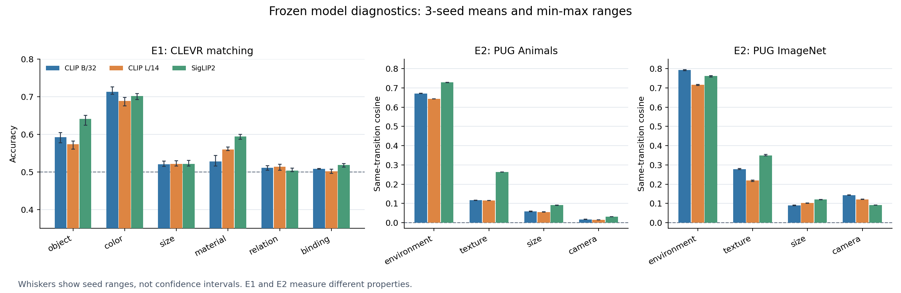

# 预实验结论深化分析：证据强度、替代解释与 GraphDelta 的下一步

日期：2026-10-28。

本文复核了原《预实验分析报告（实验做法与实际样例）》、三模型 × 三种子完整结果、逐题记录及评分/配对实现。分析只使用现有本地结果，没有重跑模型，也没有新增训练。原报告保留；本文作为结论修订和进一步解释。

**核心判断：第一阶段已充分支持“当前冻结模型的全局图文匹配对不同因素的区分很不均衡，绑定和关系是持续薄弱点”，也找到了部分可重复的视觉变化响应；但尚未建立“静态失败由变化响应不足导致”的联系，更未证明视觉 Δ 与文本 Δ 对齐。当前最合适的决策是进入小规模受控编辑验证，暂不据此进入完整方法训练。**

比原报告更具体的两个发现是：大小题的成绩几乎可由“不看图、始终选 small”复现；CoGenT 的大幅颜色单元差异混合了强烈的形状不对称。这两点会改变后续实验需要排除的替代解释。

## 1. 本文数字如何读

- 共有 **9 个模型—种子组合、每组合 5 项主要评估，共 45 项主要评估记录**。`run_meta.json` 对应记录均为 success；不使用 `_smoke` 文件。旧分析中的“18 个组合”与三模型 × 三种子的实际数量不符。
- 除明确标注 seed 0 的表格外，本文汇总使用三个 seed 的算术均值；方括号若标为“范围”，指三个 seed 的最小—最大值，**不是置信区间**。
- 现有 E1/E3 的 CI 按图聚类；E2 方向比较的 CI 考虑两个 context 端点。它们是给定模型、数据和协议下的区间，不能解释成对全部模型和场景的保证。逐单元 CI 未做多重比较校正。
- 模型全部冻结。不同 seed 主要改变题目、负例、配对或基线图片的抽样；共享模型权重、图像池和特征缓存。三种 seed 表示抽样稳健性，不能当成三次独立训练或三个独立数据集。同 seed 跨模型题目相同，有利于公平比较。
- 准确率先逐模板计算再平均。7 个模板不是 7 倍独立样本；结果也不是先将 7 个文本特征集成后再作一次二选一。
- 本地保存了结果和代码，但没有配置所指向的原始图片、场景标注与特征缓存。因此可复核保存的统计与 E3 逐题评分记录，不能重新计算编码器打分、目视检查图像或恢复未记录的负例词值。

图中误差线表示种子范围。E1 测图文匹配，E2 测视觉编辑的方向一致性，两者纵轴不能作数值上的直接比较。

## 2. E1 最稳的结论：基础概念区分与结构区分存在明显落差

### 2.1 三种子汇总后，落差依然清楚

CLEVR 准确率，单位为 %，格式为“三种子均值 [范围]”：

| 因素 | CLIP B/32 | CLIP L/14 | SigLIP2 |
|---|---:|---:|---:|
| 颜色 | 71.33 [70.60–72.58] | 68.83 [67.56–69.79] | 70.16 [69.28–70.83] |
| 形状 | 59.22 [57.75–60.47] | 57.40 [56.08–58.25] | 64.10 [62.39–65.04] |
| 材质 | 52.76 [51.61–54.40] | 56.01 [55.66–56.61] | 59.45 [58.71–60.03] |
| 大小 | 52.02 [51.50–52.89] | 52.11 [51.58–53.01] | 52.13 [51.56–53.04] |
| 关系 | 51.10 [50.44–51.66] | 51.37 [50.47–52.06] | 50.38 [50.07–50.99] |
| 绑定 | 50.85 [50.72–50.94] | 50.22 [49.63–50.76] | 51.89 [51.31–52.24] |

颜色减绑定的平均差距分别为 **20.49、18.61、18.27 个百分点**；9 个模型—种子组合中，现有差值 CI 均高于零。它比“绑定是否每次都恰好等于随机”更稳健：即使部分绑定结果略高于随机，能力差距仍然很大。

SPAR 自建动物身份题的三种子均值为 **76.52%、89.20%、98.80%**，而同模型的结构题没有相应改善。特别是 SigLIP2 的身份题接近满分，CLEVR 绑定仍只有约 52%。这说明，至少在当前三个冻结模型中，更好的身份区分没有自动带来强绑定区分。不同模型的数据、架构、分辨率和训练方式同时不同，因此这不是严格的模型规模因果实验。

**可以写进研究结论的是：模型已表现出部分原子概念区分能力，但这些能力不足以支撑可靠的属性归属和关系判断。**

### 2.2 “绑定接近随机”有力，但不等于表示里完全没有绑定信息

交换“绿球 + 红圆柱”与“红球 + 绿圆柱”时，词的集合相同，任务更依赖谁与谁对应。因此它比替换一个颜色词更直接触及 GraphDelta 关注的问题。

不过 E1 的输出是图像全局特征与文本全局特征的点积排名。失败可能来自视觉侧、文本侧、全局池化、共同空间的组织方式或点积读出，现有实验无法定位到其中一处。也可能存在局部结构信息，但没有被当前全局读出有效使用。

所以应表述为 **“当前全局零样本图文打分未能可靠利用绑定信息”**，不应直接写“视觉编码器完全不含绑定信息”。颜色与绑定的比较也没有严格匹配描述长度、目标物体数及难度，因此差值首先是任务层面的差距，而非纯粹、无混淆的绑定损失。

此外，SigLIP2 绑定 seed 1/2 分别为 52.11% [95% CI 50.34–54.00]、52.24% [50.51–53.89]。它们在未校正的单次检验中高于 50%，但效应仍小。L/14 关系题也有一个 seed 的 CI 略高于 50%。原报告“所有绑定/关系结果均无高于随机证据”过于绝对；“弱，且远落后于颜色/身份”更准确。

## 3. 大小题的新发现：略高于随机，几乎完全可由词偏好复现

E1 大小题只在 small 与 large 间替换。逐题题面中，正确描述包含 small 的数量如下：

| seed | small 正例数 / 总数 | 不看图、始终选 small | B/32 实际 | L/14 实际 | SigLIP2 实际 |
|---|---:|---:|---:|---:|---:|
| 0 | 1058 / 2000 | 52.90% | 52.89% | 53.01% | 53.04% |
| 1 | 1034 / 2000 | 51.70% | 51.66% | 51.74% | 51.79% |
| 2 | 1030 / 2000 | 51.50% | 51.50% | 51.58% | 51.56% |

这里最重要的判据是“是否优于有效的无图像基线”，而不只是“CI 是否高于 50%”。seed 0 三模型 size 的 CI 实际都高于 50%，原报告对此写错；但正确选项本来就有 52.9% 是 small，因而高于 50% 并不自动代表利用了图像大小。

按全 9 次结果核对，模型与始终选 small 基线的最大差仅 **0.143 个百分点**。由于 E1 未保存逐题分数，不能证明模型每一题都选择了 small；但聚合成绩与这个简单策略几乎相同，已经足以说明 **当前 E1 大小准确率没有提供超出该词偏好基线的有力能力证据**。

这比笼统地写“大小未编码”更有诊断价值：后续应平衡 small/large 正例，报告分方向准确率、平衡准确率，并保存逐题预测。若平衡后仍约 50%，将更有力地支持“当前协议未检出可用大小区分”的判断。

材质也需要先验对照，但情况较轻：三个 seed 的多数词基线为 51.05%、50.20%、51.55%；L/14 超出约 4.6–5.6pp，SigLIP2 超出约 8.5pp。材质弱不等于所有成绩都能被多数词解释。颜色和形状有多种负例，不能直接拿正例最大类别占比作为它们的二选一基线。

## 4. 关系与位置：结构能力偏弱成立，具体失败机制仍待验证

CLEVR 关系与绑定的成绩相近，且远低于颜色。SPAR 自建位置题却呈现明显模型差异：三种子均值 B/32 为 63.82%，L/14 为 39.99%，SigLIP2 为 54.73%。这种差异不能单独解释成某模型“理解空间”、另一模型“反向理解空间”。

现有 `template_variance` 提供了更直接的证据：SPAR position 的模板准确率标准差，B/32 约 10.9–11.4pp，L/14 约 6.35–6.65pp，SigLIP2 约 5.3–6.7pp。说明结果对描述方式敏感。词频、对象名称和方向分布可能参与，但“主要由词频导致”尚未被单独实验验证。

官方样式 hard-negative 评估提供了另一套证据，但也需要明确口径：原报告引用的约 50% 多来自 `bg=False`。包含背景描述时，有些结果更高，例如 seed 0 的 B/32 关系为 54.15%、SigLIP2 Grass 属性绑定为 58.35%。官方表没有 CI，不能宣称这些结果都不显著或完全随机。两套协议还涉及不同预处理，并非只更换了负例。

因此，跨协议支持的是 **“结构任务相对身份/概念任务偏弱，且表现受协议影响”**；不能把所有位置/关系/绑定题统一归为绝对零能力。下一步应平衡方向词和主客体、使用双向编辑，并同时报告有/无背景描述结果。

## 5. E2 的强正结果：相同背景转换具有可重复方向，但不是统一的“背景轴”

三种子平均的“同一具体 source→target 转换、不同 context”的 Δ 余弦：

| 数据集 / 因素 | B/32 | L/14 | SigLIP2 |
|---|---:|---:|---:|
| Animals 环境 | 0.672 | 0.644 | 0.729 |
| Animals 纹理 | 0.116 | 0.115 | 0.263 |
| Animals 大小 | 0.059 | 0.056 | 0.091 |
| Animals 相机 | 0.017 | 0.015 | 0.031 |
| ImageNet 环境 | 0.793 | 0.716 | 0.761 |
| ImageNet 纹理 | 0.278 | 0.219 | 0.349 |
| ImageNet 大小 | 0.090 | 0.102 | 0.120 |
| ImageNet 相机 | 0.143 | 0.121 | 0.091 |

环境在六组模型—数据集组合中始终最强，且变化幅度超出当前增强基线。这说明全局表示并非对所有编辑都只有无规律响应；某些编辑确实有可跨 context 重复的几何结构。

但这里的重复性严格依赖 **同一个具体转换**。L/14 Animals seed 0，同一环境转换跨 context 为 0.643，而同为环境、转换不同、context 也不同仅为 0.006。其他模型也是类似结构。

**被支持的是“TokyoDay→TokyoNight 这类具体转换可能具有可复现方向”，不是“所有换环境都沿同一全局向量”。** 后续即使做固定 Δ 对照，也应按具体编辑及方向定义，不能把所有背景变化合成一个向量。

环境还可能改变大量像素、光照、反射及场景风格。强方向性可能来自稳定的背景外观差分，尚不能证明模型提取了与视觉外观独立的抽象语义操作。对 GraphDelta 而言，环境可作“重复性可以检出”的正控制，不能代替局部绑定和关系编辑的机制证据。

## 6. E2 需要同时检查幅度、方向、具体编辑可区分性

### 6.1 大小有响应，但跨 context 的方向弱

原报告“大小变化幅度全部低于扰动基线”只在 Animals 成立。归一化空间中，三种子平均范数差 `E||Δ_factor|| − E||Δ_nuisance||` 为：

| 数据集 | B/32 | L/14 | SigLIP2 |
|---|---:|---:|---:|
| Animals 大小 | −0.0240 | −0.0095 | −0.1352 |
| ImageNet 大小 | **+0.0211** | **+0.0445** | −0.1297 |

ImageNet 两个 CLIP 模型的正差值在三个 seed 的现有 CI 中均高于零。L/14 Animals seed 0 的平均单位端点 Δ 范数为 0.275，对照为 0.285；响应较弱，但不能叫“几乎不动”。

同时，同具体大小转换的方向一致性减去“同因素、不同转换、跨 context”的一致性，seed 0 的 Animals 仅为 0.004–0.006，ImageNet 为 0.014–0.015。这个新增描述差值没有 CI，不能宣称统计显著与否；但它提醒我们，现有方向值可能主要包含粗略的“变大”趋势，对 small→medium 与 small→large 等细分编辑的可区分性支持有限。

现有 `transition_similarity_gap` 实际减去的是 **不同因素** 基线，而不是同因素不同转换。因此它高于零，不等于已证明具体编辑可识别。

### 6.2 视角是幅度与方向分离的例子

两个 CLIP 在相机变化上可有较大幅度，Animals 的共同方向却只有约 0.015–0.018。这个很小的效应仍可能具有高于零的 CI，不能叫完全无规律。

更合理的解释范围是：相机编辑对全局特征有影响，但用一个跨对象固定方向描述它很困难。对象形状、遮挡和可见面不同都可能影响变化。它尚未排除条件化或非线性编码，不能由此得出没有视角信息。

### 6.3 纹理是中间情形，跨数据集原因未被识别

ImageNet 纹理的一致性在三模型中都高于 Animals，这是稳定的描述现象；但两个数据集同时改变了对象、纹理种类、转换分布和场景。Animals 有 4 种纹理、6 种两两转换，ImageNet 有 9 种、36 种；“纹理语义距离更大”只是候选解释。

同样，大小取值在 Animals 为 0.7/1.0/1.3，ImageNet 涵盖 0.5–1.6 的七个尺度；不能把大小方向增强直接归因于模型在另一数据集更有能力。

### 6.4 nuisance 并非零均值、完全无语义变化的噪声

当前对照是两个独立裁剪视图，加上固定 JPEG90→75 方向。裁剪可能改变对象可见性、相对大小与上下文，因此它只能代表 **这套指定增强的参考响应**，不能当成所有无语义变化的统一噪声上限。

而且 nuisance 自身有方向性。seed 0 的 nuisance Δ 两两余弦约为：Animals B/32 0.069、L/14 0.092、SigLIP2 0.411；ImageNet 约为 0.081、0.078、0.410。SigLIP2 的增强方向一致性甚至高于其纹理方向一致性。可见“余弦非零”本身不足以证明语义规律。两个数值的生成和抽样结构不同，未经专门检验也不能直接将它们相减后称为显著优势。

最后，raw 特征幅度带有模型自身尺度。原报告 `+7.86` 与 `+4.54` 不能直接用来给模型的语义强弱排名。应同时看端点归一化后的范数差、模型内基线比例和方向指标；即便归一化，跨架构比较也受预处理和分辨率影响。

## 7. E2 覆盖量修正：环境聚合不是充分的单转换证据

原报告中的 Animals“约 149 contexts/环境转换”和 ImageNet“每转换 3–4 contexts”均与当前转换表不符。

seed 0 的实际结构如下，三模型同 seed 一致：

| 数据集 | 环境配对总数 | 观察到的转换数 | 每转换 context 数 | 至少 2 context 的转换 |
|---|---:|---:|---|---:|
| Animals | 13,440 | 2,016 | 3–11，均值 6.67 | 2,016 |
| ImageNet | 2,896 | 1,939 | 1–4 | 832 |

ImageNet 中 **1,107 / 1,939，即约 57.1% 的已观察转换只有一个 context**，无法单独估计跨 context 余弦；711 个有两个、117 个有三个，只有 4 个有四个。聚合环境结果来自 1,086 次抽样比较、972 个独特比较，而非其他因素常见的 20,000 次比较。

因此，跨数据集背景强重复性的描述有支持，但 ImageNet 只能作为较稀疏的补充验证。不能用整体聚合的高值，替每一个单独转换作保证。后续最有价值的是增加每个转换的独立对象/context 覆盖，而不只是增加总配对数。

## 8. E3 的深化结论：形状不对称与颜色交互，需要拆开解释

### 8.1 先纠正 A/B 条件定义

原报告“cube/cylinder 在 A 只配 red、blue，B 配其余六色”是事实错误。配置中的划分为：

| 条件 | cube | cylinder | sphere |
|---|---|---|---|
| A | gray、blue、brown、yellow | red、green、purple、cyan | 全部八色 |
| B | red、green、purple、cyan | gray、blue、brown、yellow | 全部八色 |

所以对非球形物体而言，同一颜色在 A/B 之间会换正例形状。例如 red 在 A 对应 cylinder，在 B 对应 cube。按颜色的 A−B 混合了颜色、形状、上下文及负例分布，不能当成控制形状后的纯颜色效应。

### 8.2 新的关键发现：L/14 的换形题，在两个条件下都明显偏向 cube

按正例形状汇总换形题，三种子平均准确率为：

| 模型 | A cube | A cylinder | B cube | B cylinder |
|---|---:|---:|---:|---:|
| B/32 | 89.27% | 59.11% | 83.80% | 53.84% |
| L/14 | **88.18%** | **32.21%** | **88.69%** | **32.85%** |
| SigLIP2 | 60.61% | 77.00% | 57.50% | 68.05% |

L/14 的 cube 优势在 A、B 两个条件和三个 seed 中都存在。因此 red 的 A−B 大幅为负、yellow 大幅为正，很大程度与“red 从圆柱变成立方体、yellow 从立方体变成圆柱”一致。这比将现象全部归为某些颜色组合特别难，更能解释结果结构。

但形状也没有解释全部差异：L/14 seed 0 的 A cylinder 换形题中，red 16.15%、green 53.37%；A cube 中，brown 77.72%、yellow 97.96%。所以应保留 **形状不对称与颜色交互共同存在** 的结论。

SigLIP2 的形状方向相反，则说明这不是某个渲染形状对所有模型都天然更容易。文本偏好、图像可见性、形状词与图像的对齐、场景共现和负例候选都可能参与；现有记录不足以定位原因。

### 8.3 全局 A−B 差距不稳定地代表所有模型，也不能代表泛化

cube/cylinder 的题型等权主差值：

| 模型 | seed 0 | seed 1 | seed 2 | 三种子均值 |
|---|---:|---:|---:|---:|
| B/32 | +3.97pp | +5.68pp | +4.35pp | +4.66pp |
| L/14 | −0.65pp | −0.93pp | +0.73pp | −0.28pp |
| SigLIP2 | +3.58pp | +6.81pp | +5.21pp | +5.20pp |

B/32 与 SigLIP2 三个 seed 的 CI 均在零以上；L/14 三次均含零，连点估计符号也改变。因此稳定的是“L/14 没有检出整体差值”，不是它的 A−B 点估计方向一直相同。

L/14 的整体接近零，同时伴随按颜色的大幅正负差和 cube/cylinder 的方向不对称，说明总体平均不足以描述模型能力。反过来，也不能从某个极差单元推出该模型整体最差。

sphere 对照并非处处为零：SigLIP2 seed 0 为 +2.33pp，CI 高于零，其余两 seed 接近零。因此该次非球形 A−B 不能全部归因于组合约束。后续可增加“非球形差值减球形差值”的联合检验，但必须按图片联合 bootstrap，不能相减两组 CI 端点。sphere 的负例也受场景和 A/B 配色影响，控制并不完美。

冻结模型未进行 train-on-A，A/B 也不是同一场景的 before/after 配对。E3 只能说明 **条件相关、模型相关的组合匹配难度异质性**，不能报告成未见组合泛化下降，更不能解释成组合因素的单独因果效应。

### 8.4 实际样例能说明什么

L/14 seed 0，`CLEVR_valA_003948.png` 的 red cylinder：换色题对 5/7 模板，平均 margin +0.00105；换形题对 0/7，margin −0.05163。这确实说明同一图上的两类候选区分可以很不一样。

但该图换形题在三个模型中都是 0/7，而 A red cylinder 换形组整体为 B/32 57.14%、L/14 16.15%、SigLIP2 72.40%。共同失败的一个样例无法代表总体模型排序。

另外，E3 JSONL 没有保存具体负例颜色/形状及对象索引。以上分数可以确认，但“负例具体是 red cube”只能引用原报告按外部标注复原的说明，本地现有记录无法独立确认。今后应把它作为记录缺口修复。

## 9. 对 GraphDelta：问题动机充分，变化机制链条仍缺一环

| 研究判断 | 当前证据状态 | 可以采用的结论 |
|---|---|---|
| 当前全局匹配存在结构薄弱点 | 强 | 绑定/关系显著落后于颜色/身份 |
| 所有因素在表示中都没有变化规律 | 被结果否定 | 至少具体背景转换有强重复性 |
| 大小完全未编码 | 未证明 | E1 可被词偏好复现，E2 方向弱但响应可测 |
| 组合难度对所有模型以同一方式不均衡 | 不支持 | 不均衡普遍存在，具体形状和颜色模式依模型而变 |
| 绑定/关系失败是由视觉 Δ 不足导致 | 未测 | E1 没有配对视觉编辑，E2 没有核心绑定编辑 |
| 视觉 Δ 与文本 Δ 表示同一种结构编辑 | 未测 | 当前文本增强对照不能替代语义编辑对齐 |
| context-conditioned Δ 优于固定 Δ | 未测 | 弱全局方向只是研究动机，不是方法比较结果 |
| GraphDelta 能改善未见组合泛化 | 未测 | 没有相关训练和严格保留组合测试 |

E1 和 E2 不是针对同一组核心结构编辑的两端证据，不能直接拼成因果链。E3 也没有补齐这条链。因此对第一阶段的评价是 **“研究问题已成立，机制值得验证，但并未完整达到最强版本的全部成功条件”**。

一个能直接衔接静态匹配与变化对齐的量是：对同场景受控配对 `(I0,T0)`、`(I1,T1)`，使用端点各自归一化后的特征，定义

\[
\Delta_v=z_v(I_1)-z_v(I_0),\qquad
\Delta_t=z_t(T_1)-z_t(T_0).
\]

若 `s(I,T)=z_v(I)·z_t(T)`，则严格有：

\[
\Delta_v\cdot\Delta_t
=s(I_1,T_1)+s(I_0,T_0)-s(I_1,T_0)-s(I_0,T_1).
\]

这将“正确配对是否整体胜过交叉错配”与跨模态 Δ 联系起来，可以作为第二阶段的基础检查。它仍不是充分条件：总和为正，可能掩盖其中一条单向匹配失败；还要检查两个方向各自的 margin、配对准确率及 held-out context。Δ 范数接近零时，余弦也可能不稳定，需要同时报告范数。

## 10. 下一步最值得做的最小验证

1. **先补齐读出与记录对照。** 平衡大小正例；加入始终选 small 等无图像基线；保存 E1/E3 每题 s+、s−、完整正负描述、模板、对象索引；保存 E2 配对 ID、转换方向与 context。它们直接对应本轮发现的解释缺口。
2. **构建同场景编辑，平衡两个方向。** Color Change 作局部正控制；Binding Swap 与 Relation Change 作核心。绑定交换保持颜色集合、对象集合、位置、相机和光照；关系编辑还要匹配移动距离、遮挡和可见性，避免只识别运动量。加入编辑强度/改变像素面积相近的非结构对照。
3. **分别检查编辑响应、可识别性与跨模态对应。** 先确认 Δ 不被数值噪声支配；再比较同编辑、同因素其他编辑、不同因素和增强对照。图文对齐比较同场景匹配的 Δv/Δt、同编辑跨 context 配对、不同编辑与打乱配对；同编辑跨 context 可能也是正证据，不应预先将其一概当成负例。反向编辑属于方向检查，其 Δ 取负是代数事实，不能单独当成新能力证据。
4. **验证可迁移性，而不只是当前池内重复。** 按对象身份、颜色—形状组合、背景或场景家族整体划分 held-out context；同一基础场景的派生图和配对不能跨训练/测试泄漏。若训练 probe，同时比较 before-only、after-only、端点拼接和 Δ 输入，并保持参数预算与划分公平。
5. **根据结果决定方法复杂度。** 若有稳定视觉编辑信息但跨模态对齐弱，优先研究对齐；若全局 Δ 弱而局部或条件化读出有效，再研究结构/局部模块；若基础概念正控制都失败，先排查数据和协议；若核心绑定/关系编辑始终无可利用信号，应调整编码方式，不能只凭环境的强结果继续堆叠 Δ 模块。

现有三个冻结模型已足以支持本轮问题诊断，继续扩充大量同类 baseline 的收益可能小于上述受控验证。此时的主要不确定性已经从“问题是否存在”转向“信息在哪里、是否与语义编辑对应、能否迁移”。

## 11. 结果复核与复现材料

- 复核汇总：[`preexperiment_deep_metrics_2026-10-28.csv`](preexperiment_deep_metrics_2026-10-28.csv)。包含三种子值、均值、范围及现有 CI 与参照值的关系；不把种子汇总伪装成新 CI。
- 来源与检查：[`preexperiment_source_audit_2026-10-28.json`](preexperiment_source_audit_2026-10-28.json)。保存 9 次运行状态及消费文件 SHA256。E3 派生表与来源指纹已核对；Windows 检出后的 CRLF/LF 差异按换行归一化匹配，保留实际字节 SHA256。
- 汇总与绘图脚本：[`../../scripts/summarize_preexperiment_conclusions.py`](../../scripts/summarize_preexperiment_conclusions.py)，仅读取已有产物，不加载模型、不修改原始实验结果。
- E1 详细核查：[`audit_e1_notes.md`](audit_e1_notes.md)、[`audit_e1_counts.json`](audit_e1_counts.json)。
- E3 详细核查：[`audit_e3_notes.md`](audit_e3_notes.md)、[`e3_shape_negative_audit.csv`](e3_shape_negative_audit.csv)。
- E2 来源：各模型各 seed 的 `e2_delta_stats*.csv`、`e2_transition_stats*.csv`；机制定义参见 `src/experiments/e2_change_diagnosis.py`、`src/metrics/delta_stats.py` 与 `src/data/pair_matcher.py`。

注意：运行元数据记录 `git_dirty=true`，同 commit 不能保证执行代码逐字节相同；本轮检查确认保存产物及派生表的一致性，并不等于在当前机器重放了原始推理。
